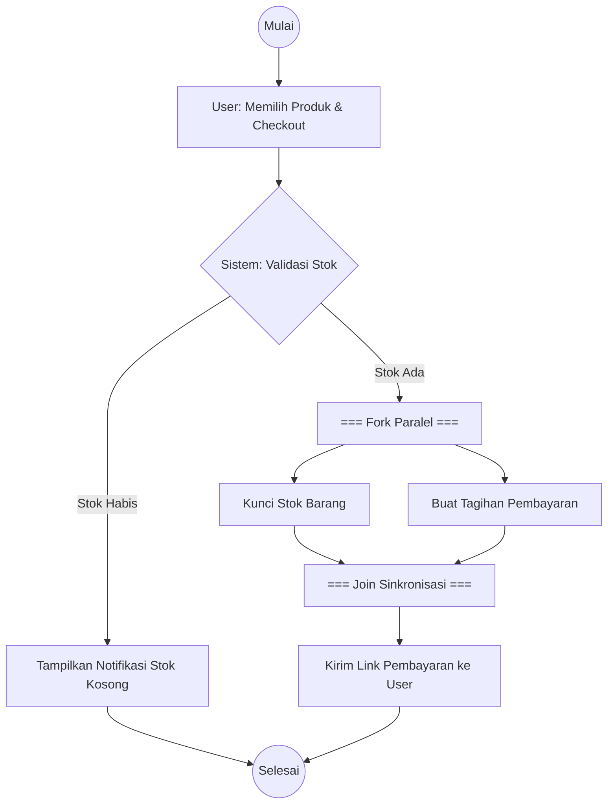

# Skill: Activity Diagram & Business Process Workflow (Gilang Ramadhan)

## Deskripsi
Keahlian khusus dalam menganalisis proses bisnis, memetakan alur kontrol sistem menggunakan **UML Activity Diagram**, perancangan partition/swimlane antar entitas/sistem, serta perancangan diagram interaktif berbasis **Mermaid** dan **PlantUML**.

## 1. Prinsip Utama Activity Diagram
- **Initial Node & Final Node**: Titik awal (*filled circle*) dan titik akhir (*bull's eye*).
- **Actions / Activities**: Tugas atomic yang dilakukan oleh aktor atau sistem (kotak bersudut melengkung).
- **Decision & Merge Node**: Simbol diamond untuk percabangan berbasis kondisi guard `[kondisi]` dan penggabungan kembali alur kontrol tanpa sinkronisasi konkuren.
- **Fork & Join Node**: Baris hitam tebal untuk proses konkuren (paralel) dan sinkronisasi menunggu semua jalur paralel selesai sebelum melangkah.
- **Swimlanes / Partitions**: Membagi alur kerja secara vertikal/horizontal berdasarkan aktor penanggung jawab (contoh: *User*, *Sistem Frontend*, *Payment Gateway*, *Warehouse*).

## 2. Standar Format Output (Mermaid Sintaks)
Sertakan diagram Mermaid yang siap di-render bersama dengan tabel penjelas alur aktivitas:

## 3. Matriks Skenario & Exception Flow
Selalu sertakan:
1. **Happy Path (Main Success Scenario)**: Alur optimal dari awal sampai akhir berhasil.
2. **Alternative & Exception Flow**: Apa yang terjadi jika pembayaran timeout, stok habis, otentikasi gagal, atau koneksi pihak ketiga terputus.
3. **Business Rules**: Syarat dan aturan validasi di setiap *Decision Node*.
