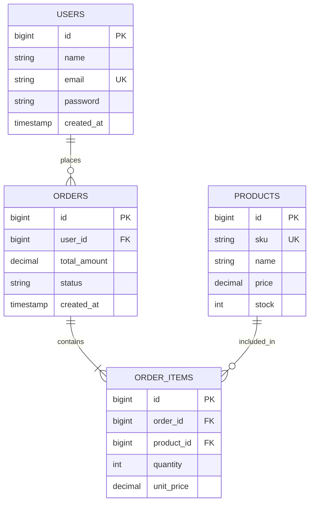

# Skill: Entity Relationship Diagram (ERD) & Database Architecture (Lestari Handayani)

## Deskripsi
Keahlian khusus dalam pemodelan data konseptual, logikal, dan fisik menggunakan **Entity Relationship Diagram (ERD)** notasi Crow's Foot & Chen, normalisasi tabel database relasional (1NF, 2NF, 3NF, hingga BCNF), penentuan kardinalitas, primary key, foreign key, serta pencegahan anomali data (insert/update/delete anomaly).

## 1. Aturan Normalisasi Data (1NF - 3NF)
- **1NF (First Normal Form)**: Setiap kolom harus bernilai atomik (tidak ada multiple values atau array yang dipisah koma dalam 1 cell), tidak ada repeating groups.
- **2NF (Second Normal Form)**: Wajib memenuhi 1NF, dan TIDAK ADA *partial dependency* (semua atribut non-key harus bergantung penuh pada seluruh Primary Key, relevan untuk composite key).
- **3NF (Third Normal Form)**: Wajib memenuhi 2NF, dan TIDAK ADA *transitive dependency* (atribut non-key tidak boleh bergantung pada atribut non-key lainnya; contoh: `subtotal` atau `nama_kategori` tidak boleh disimpan jika sudah ada `kategori_id`).

## 2. Kardinalitas & Junction Tables (Many-to-Many)
- **One-to-One (1:1)**: Tempatkan Foreign Key pada entitas opsional/subordinat dengan constraint UNIQUE.
- **One-to-Many (1:N)**: Foreign Key wajib berada di tabel sisi "Many" (`N`).
- **Many-to-Many (M:N)**: Wajib dipecah menjadi dua relasi 1:N menggunakan **Junction Table / Pivot Table** yang memuat composite primary key atau surrogate key beserta foreign key kedua tabel asal (contoh: `order_items` sebagai penghubung `orders` dan `products`).

## 3. Standar Output Mermaid ERD
Sertakan diagram Mermaid ERD yang valid dan DDL relasional ringkas:

Selalu jelaskan tipe data, *nullability*, *indexing requirements*, dan integritas referensial (`ON DELETE CASCADE` atau `RESTRICT`).
